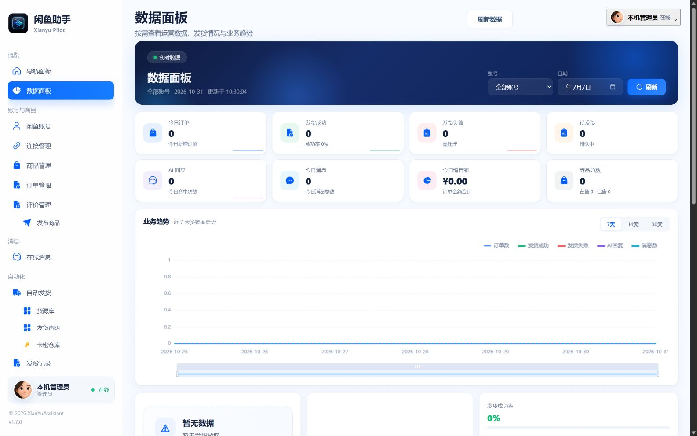
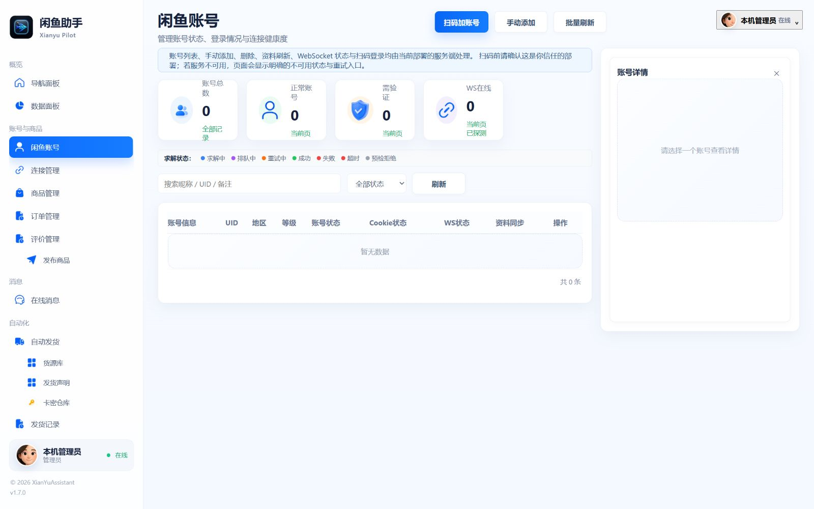
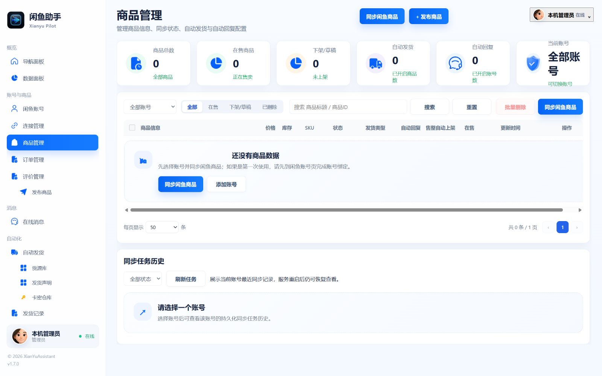
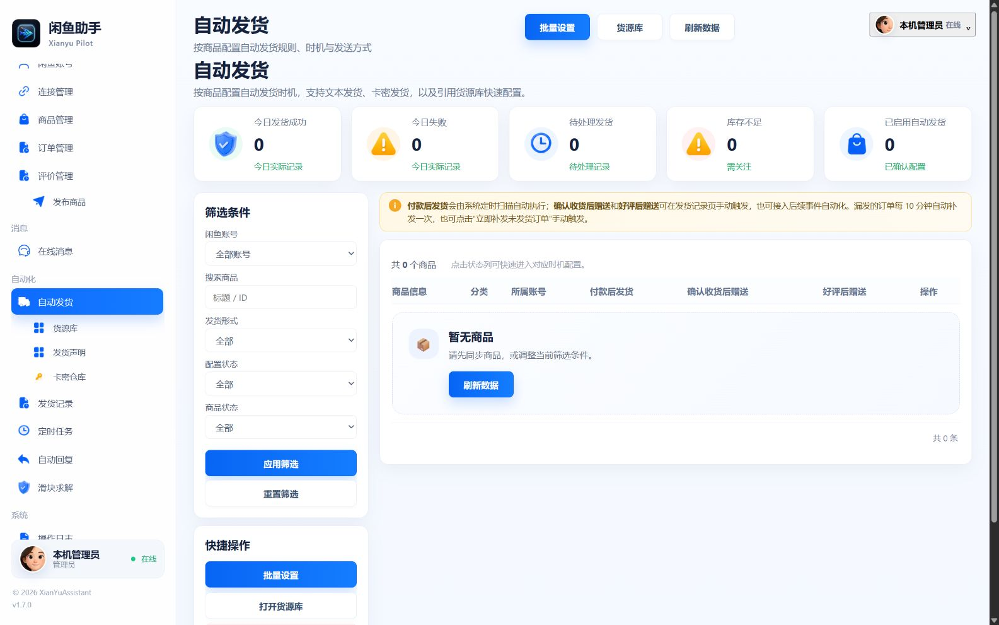
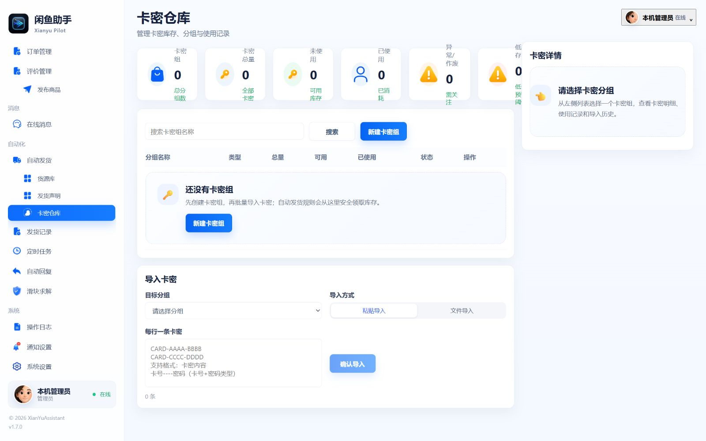
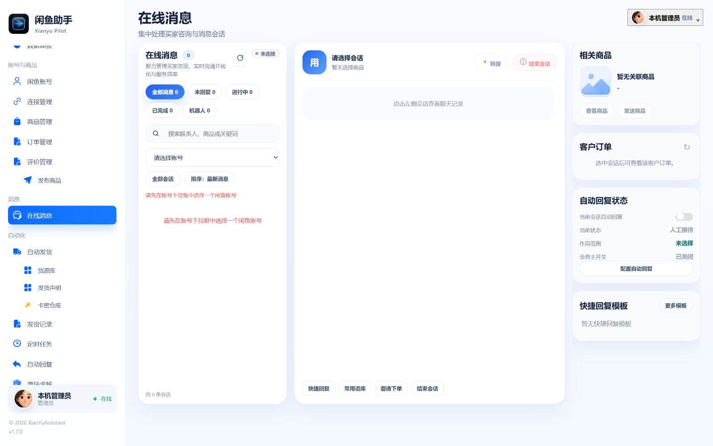

<div align="center">


# 闲鱼助手 · Xianyu Pilot

**面向个人卖家的本地桌面工作台**

把账号、商品、消息、订单、卡密与自动化配置集中在一个窗口。


[下载与运行](#下载与运行) · [界面预览](#界面预览) · [功能一览](#功能一览) · [数据与升级](#数据与升级) · [开发与构建](#开发与构建)

</div>

> **当前状态 · 2026-10-31**
>
> Windows 目录版与单文件 EXE 已完成本地构建，并通过启动、中文路径搬移和内嵌控制台加载/退出检查。完整 Vue 后台与 SQLite 已接入，采用新版小鱼图标。真实账号登录、平台收发、真实订单履约及长时间运行仍需实际联调验收。



## 为什么做这个桌面版

- **双击运行**：便携包内置 Python、Qt 和 Chromium，使用者无需安装 Python、Node.js 或额外浏览器运行时。
- **数据留在程序旁**：桌面版使用 SQLite，业务文件统一保存在 `data/`，备份和搬移有明确位置。
- **沿用完整后台**：继续使用原项目的业务页面、导航和接口，覆盖日常运营流程。
- **支持后台驻留**：关闭窗口后进入托盘，可重新打开、暂停/恢复发货或安全退出。
- **减少操作干扰**：优化启动、按需加载与图表刷新，修复托盘退出后进程残留问题。

当前方向是**单用户、本机运行的 Windows 桌面软件**。桌面模式不要求 Docker、MySQL 或 Redis；原服务端开发流程仍单独保留。QQ 等外部聊天机器人不在当前交付范围。

## 下载与运行

### 1. 选择合适的包

前往 [GitHub Releases](https://github.com/12-test-12/xianyu-pilot/releases) 查看已发布附件，核对该版本的说明与 `SHA256SUMS.txt`。

| 文件 | 适合谁 | 使用方式 |
| --- | --- | --- |
| **`XianyuPilot-Windows-x64.zip`** | 日常使用，推荐 | 完整解压后运行文件夹中的 `XianyuPilot.exe`；保留 `_internal/` |
| **`XianyuPilot.exe`** | 希望只携带一个程序文件 | 直接运行；启动时会临时展开运行组件，打开时可能需要等待 |
| 源码 ZIP | 开发者 | 包含源码与构建资源，需要自行准备开发依赖 |

**公开下载以 Releases 实际附件为准。本地构建完成不代表对应修改已经发布到远端。**

GitHub 流水线将小鱼图标直接嵌入独立 EXE 和 ZIP 内的 EXE，下载后无需启动或另行替换图标。打包与发布前会核对 EXE 内全部七种尺寸的图标资源；错误或缺失图标会阻断发布。校验机制与报告位置见 [应用图标与发布校验](docs/app-icon-integration.md)。

### 2. 启动软件

把程序放在**有写入权限的普通文件夹**中。目录版务必完整解压，不要只复制其中的 EXE。

```text
XianyuPilot/
├─ XianyuPilot.exe          ← 双击运行
├─ _internal/              ← 目录版必需的运行组件
└─ data/                   ← 首次运行自动创建，升级时保留
```

首次启动使用空白本地工作区，不附带账号、订单或卡密。桌面宿主会建立本机会话并打开控制台。

### 3. 按业务顺序配置


1. 在「闲鱼账号」添加账号并完成授权，检查 Cookie 与连接状态。
2. 在「商品管理」同步商品，核对账号、商品和规格的对应关系。
3. 在「卡密仓库」准备库存，或在「货源库」配置对应内容。
4. 按需配置自动发货、自动回复及 AI 模型；启用前核对作用范围和规则。
5. 通过订单、消息、发货记录和日志检查实际结果。真实平台链路仍需用已授权账号完成联调，不以界面开关或离线测试代替验收。

### 4. 正确退出

**右上角 × 表示隐藏到托盘，后台仍在运行。** 需要完全关闭时，右键系统托盘中的小鱼图标，选择「退出程序」，等待安全退出完成后再移动、备份或升级文件。

## 界面预览

以下截图采集于 **2026-10-31**，来自当前前端的全新空白本地工作区，展示真实的空状态与新版图标，不包含真实买家资料、账号凭据或卡密。点击图片可以查看大图。

| 账号管理 | 商品管理 |
| --- | --- |
| [](screenshots/readme/accounts.jpg) | [](screenshots/readme/products.jpg) |
| 查看账号、授权和连接状态 | 按账号管理商品及自动化配置 |

| 自动发货 | 卡密仓库 |
| --- | --- |
| [](screenshots/readme/auto-delivery.jpg) | [](screenshots/readme/card-warehouse.jpg) |
| 按商品维护发货规则与触发配置 | 管理卡密分组、导入与库存状态 |

<details>
<summary>查看在线消息界面</summary>



没有添加账号时，会显示账号选择及空会话状态；接入后的收发结果以平台响应和实际记录为准。

</details>

## 功能一览

| 模块 | 当前页面与本地接口覆盖 |
| --- | --- |
| **概览与数据** | 功能导航、业务统计、趋势图与实时事件展示 |
| **账号与连接** | 账号管理、扫码/手动添加入口、Cookie 状态、WebSocket 连接与资料刷新 |
| **商品与订单** | 商品管理、发布入口、订单查询、筛选、明细及同步入口 |
| **自动发货** | 商品/规格配置、发货规则、货源库、发货声明与执行记录 |
| **卡密仓库** | 分组、批量导入、去重、库存状态、使用记录与导出 |
| **消息与自动回复** | 会话列表、在线消息、回复规则、AI 客服与模型配置 |
| **系统与辅助工具** | 操作日志、通知配置、定时任务、评价与滑块记录等原后台模块 |

这里描述的是已接入的页面和接口范围。平台相关操作、AI 服务及异常履约是否可用，还取决于账号授权、外部配置和对应链路的真实验证。

### 发货与库存的处理原则

库存、任务状态和审计记录保存在本地数据库中。安全处理逻辑覆盖整单库存占用、逐段记录、重启恢复及重复事件处理；**发送结果不明时保留原订单与卡密绑定，避免直接回库或整单重发**。

内容发送与平台确认发货分别记录。详细状态机和接口设计见 [自动发货设计](docs/desktop-delivery-design.md)、[官方核验与双监听](docs/official-order-delivery.md) 和 [资产安全与恢复](docs/delivery-safety-recovery.md)。

## 当前验证范围

| 已有验证记录 | 仍待实际验收 |
| --- | --- |
| 目录版及独立 EXE 本地构建 | 真实账号登录、Cookie 失效与恢复 |
| 从外部工作目录启动、中文路径搬移、数据库身份保留 | 真实订单、文本/图片发送与平台履约确认 |
| 移除开发 PATH 后加载内嵌原控制台及主要接口 | 长时间运行、真实托盘交互、休眠及断网恢复 |
| 本地库存与安全逻辑回归、Qt 窗口与退出回归 | 干净 Windows 虚拟机、跨盘搬移、物理断电及完整 I/O 跟踪 |

近期已完成：启动与刷新优化、删除历史测试前端/临时工作台、托盘退出修复，以及 Gemini「黑曜石极光」小鱼图标的统一接入。

验证依据与实施细节：[桌面性能记录](docs/desktop-performance.md) · [退出修复记录](docs/desktop-exit-fix.md) · [应用图标接入](docs/app-icon-integration.md)。部分较早的阶段文档保留历史快照，阅读时请同时核对文首后续更新。

## 数据与升级

桌面版的业务数据固定放在**程序所在目录的 `data/`** 中。源码运行时对应项目根目录；冻结运行时对应 EXE 旁的目录。

```text
data/
├─ app.sqlite3             # SQLite 业务数据库
├─ app.sqlite3-wal         # 数据库运行时可能生成的 WAL 文件
├─ app.sqlite3-shm         # 数据库运行时可能生成的共享内存文件
├─ assets/                 # 本地素材与内容快照
├─ uploads/                # 上传文件
├─ profiles/               # 本地浏览器资料与 credentials.key
├─ logs/                   # 日志与故障记录
├─ tmp/                    # 临时文件及下载
└─ backups/                # 备份目录；不代表已具备自动备份功能
```

升级或搬移时：**从托盘退出 → 备份整个 `data/` → 更新程序及运行组件 → 保留原 `data/` 后启动核对**。

- 不要在运行中仅复制 `app.sqlite3`，遗漏 WAL 可能导致备份不完整。
- `data/profiles/credentials.key` 与加密资料一起保留，避免丢失已有凭据的解密能力；跨电脑后平台仍可能要求重新授权。
- 目录版更新时保留匹配的 `_internal/`；遇到迁移或数据库异常，先保留数据与日志再排查。
- 本机业务数据不会随空白发布包分发。单文件 EXE 的运行组件会临时展开，业务数据仍保存在 EXE 旁；完整系统 I/O 隔离尚待实测。

## 开发与构建

普通使用者直接使用 Windows 便携包即可。下面的命令面向开发者，当前 CI 基线为 **Python 3.11、Node.js 22.23.1、npm 10.9.8**。

### 源码启动本地控制台

在项目根目录使用 PowerShell：

```powershell
py -3.11 -m venv .venv
.\.venv\Scripts\python.exe -m pip install --require-hashes -r apps/api/requirements.txt

cd apps/web
npm ci
npm run build
cd ../..

.\start-desktop.bat
```

浏览器访问 `http://127.0.0.1:15177/`；就绪检查为 `http://127.0.0.1:15177/health/ready`。这是本机后端开发入口，终端按 `Ctrl+C` 退出。

### 运行原生窗口或构建 EXE

```powershell
.\.venv\Scripts\python.exe -m pip install -r packaging/windows/requirements-build.txt
.\.venv\Scripts\python.exe apps/api/run_portable.py
```

前端构建完成后，在 Windows 上打包：

```powershell
.\.venv\Scripts\python.exe -m PyInstaller packaging/windows/xianyu_portable.spec --noconfirm --distpath dist/windows --workpath build/windows
```

打包前核对依赖和 PATH，避免其他软件的同名 DLL 混入。构建、校验和发布流程见 [桌面控制台与 Windows 发布](docs/desktop-console-release.md)、[Windows 便携宿主](docs/windows-portable.md) 和 [CI 流水线](docs/ci-pipeline.md)。原 MySQL/Redis 服务端开发另见 [本机开发说明](docs/local-dev-runbook.md)。

## 项目结构与文档

```text
apps/
├─ api/                    # FastAPI、SQLite 适配、原生桌面宿主与业务服务
├─ web/                    # Vue 3 后台与应用图标
├─ crawler/                # 采集辅助组件
└─ desktop/                # 历史离线回归模块，不是正式桌面入口
packaging/windows/         # PyInstaller 配置与打包依赖
scripts/                   # 构建、校验及发布脚本
screenshots/readme/        # 当前版本 README 截图
docs/                      # 设计、验证及开发文档
```

| 想了解什么 | 文档 |
| --- | --- |
| 桌面入口、依赖边界与发布规则 | [完整控制台与 Windows 发布](docs/desktop-console-release.md) |
| SQLite、目录结构及数据迁移 | [桌面存储基础](docs/desktop-sqlite-foundation.md) |
| 发货、库存与恢复设计 | [发货设计](docs/desktop-delivery-design.md) / [资产安全](docs/delivery-safety-recovery.md) |
| 最近的启动、刷新和退出修复 | [性能记录](docs/desktop-performance.md) / [退出记录](docs/desktop-exit-fix.md) |
| 图标来源与重新生成 | [Gemini 图标接入](docs/app-icon-integration.md) |
| 较早阶段的待办与验收背景 | [历史进度快照](docs/project-status-and-remaining-work.md) |

## 反馈与许可

遇到问题可提交 [Issue](https://github.com/12-test-12/xianyu-pilot/issues)，说明版本、包类型、操作步骤和预期结果。提供截图或日志前，请移除 Cookie、Token、买家资料及卡密内容。

项目基于原有开源 Vue 后台与 Python 业务持续改造，沿用仓库中的 [Apache-2.0 许可证](LICENSE)。分发或修改时请保留已有版权、许可证及上游署名。
